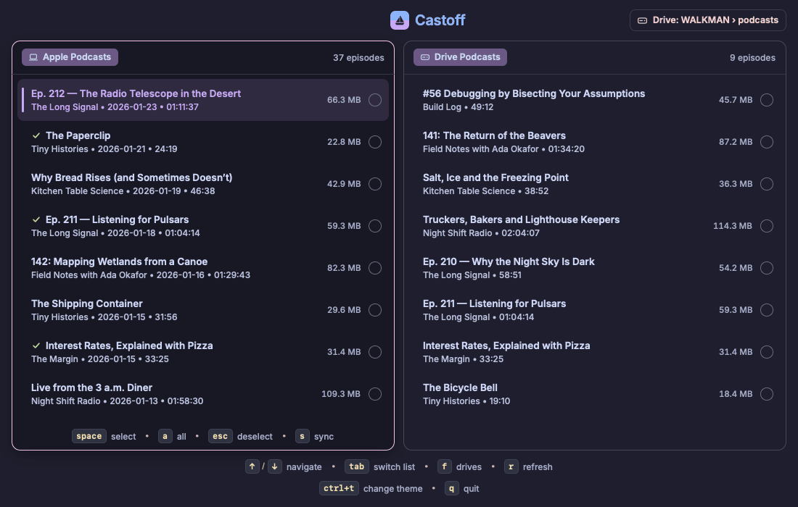

# ⛵ Castoff

A native macOS app that copies your downloaded Apple Podcasts episodes to an external drive or Digital Audio Player (DAP).



> [!IMPORTANT]
> macOS only: Castoff reads the local macOS Podcasts database.

## Features

- 🔄 **Sync** selected episodes to an external drive, with live progress and cancel.
- 🗑️ **Manage the drive**: see what is already on it and delete what you have finished.
- 💾 **Drive detection**: notices drives as they are plugged in, and selects your favourite automatically.
- 🏷️ **Device-friendly files**: ID3 tags on MP3s and file names that are safe on FAT32/exFAT.
- 🎨 **14 themes**, keyboard and mouse.

## Installation

### Homebrew

```bash
brew tap joncrangle/tap
brew install --cask castoff
```

### Mise

```bash
mise bootstrap packages use -g brew-cask:joncrangle/tap/castoff
```

### Download

Get `Castoff.app` from the [latest release](https://github.com/joncrangle/castoff/releases). Castoff is not notarized, so macOS blocks a downloaded copy the first time. Open it once, then choose **Open Anyway** under System Settings → Privacy & Security, or run:

```bash
xattr -dr com.apple.quarantine /Applications/Castoff.app
```

## Development

Requires [Rust](https://rustup.rs) and [`just`](https://github.com/casey/just).

```bash
git clone https://github.com/joncrangle/castoff.git
cd castoff
just demo         # Run with made-up data; touches nothing real
just start        # Run against your Podcasts library and drives
just full-check   # Check, lint and test
just install      # Build Castoff.app and copy it to /Applications
just --list       # Show all commands
```

Built with [Rune](https://github.com/anomalyco/rune).

## License

[GPL-3.0](./LICENSE)
